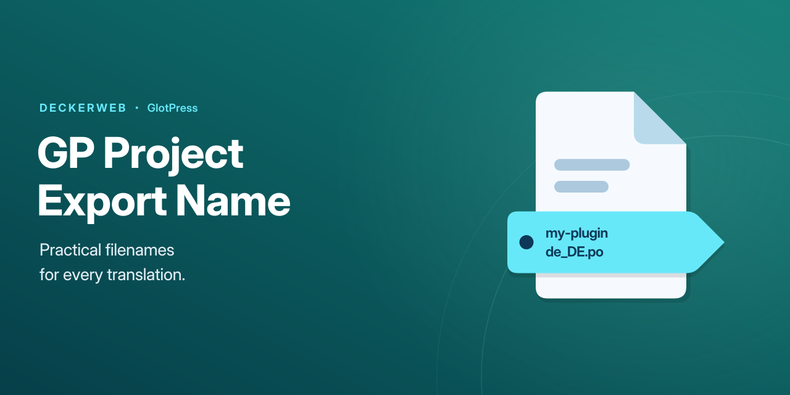
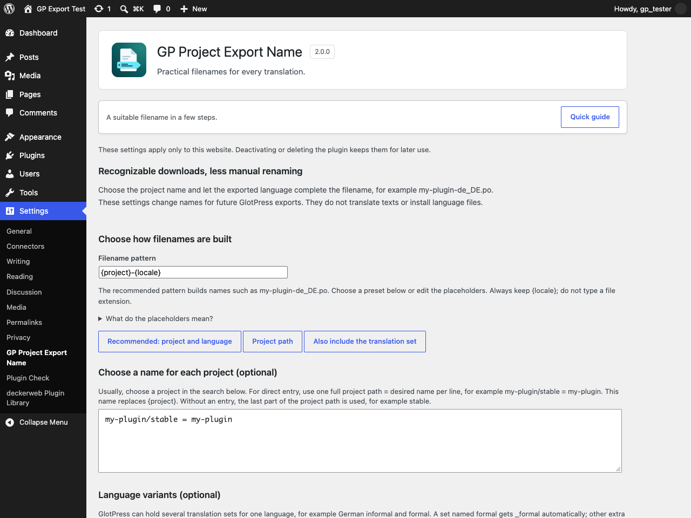
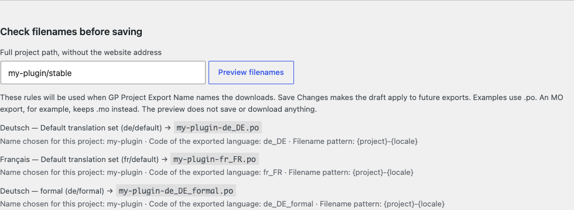

# GP Project Export Name

[Deutsch](docs/README-de.md)

**2.0.0** · WordPress 6.4+ · PHP 8.1+ · GlotPress 4.0+

[Illustrated guide](https://github.com/deckerweb/gp-project-export-name/wiki/User-guide) · [Wiki](https://github.com/deckerweb/gp-project-export-name/wiki)

## About

Download GlotPress translations with names that are easier to recognize and prepare for their destination. Choose a project name, keep the exported language and distinguish informal, formal or other translation sets. The translation itself stays unchanged.

Version 2.0.0 · WordPress 6.4+ · PHP 8.1+ · GlotPress 4.0+ with a permalink structure other than Plain for export features.

[Quick guide](https://github.com/deckerweb/gp-project-export-name/wiki/User-guide) · [Full guide and FAQ](https://github.com/deckerweb/gp-project-export-name/wiki/FAQ)

[At a glance](#at-a-glance) · [Getting started](#getting-started) · [Quick guide](#quick-guide) · [Filename patterns and placeholders](#filename-patterns-and-placeholders) · [Check filenames](#check-filenames) · [Responsible naming plugin](#responsible-naming-plugin) · [Bulk downloads](#bulk-downloads) · [Fixed language code](#fixed-language-code) · [Updates and privacy](#updates-and-privacy) · [Moving from the old version](#moving-from-the-old-version) · [Stored data](#stored-data) · [Find projects](#find-projects) · [Settings backup and import](#settings-backup-and-import) · [Reset settings](#reset-settings) · [FAQ by topic](#faq-by-topic) · [Changelog](#changelog)

## At a glance

- Choose recognizable project names instead of renaming each downloaded file.
- Use the exported language, including formal and other variants.
- Check every translation set’s filename before saving changes.
- Find projects without typing their full path.
- Keep otherwise identical names distinct within a project.
- Choose which recognized naming plugin is responsible.
- Back up, transfer or reset filename settings after reviewing the changes.
- Read the five-step quick guide directly on the settings page.

## Getting started

Activate the plugin and open Settings → GP Project Export Name. GlotPress must be active with a permalink structure other than Plain (Settings → Permalinks). Quick guide is available on the settings page even before GlotPress is ready. Start with its five steps; the advanced fields can remain unchanged.

## Quick guide

GlotPress names downloads from its project structure. That name is not always the name needed when using the translation elsewhere. GP Project Export Name lets the project name, language code and language variant determine the download name, so less manual renaming is needed.

### Example: a plugin translation for WordPress

- Typical GlotPress download: `my-plugin-stable-de.po`
- With a project name chosen here: `my-plugin-de_DE.po`

Example for the project my-plugin/stable, with my-plugin chosen as its project name and the recommended pattern. The language comes from the exported translation, not from your WordPress account language.

1. **Start with the recommended pattern**

   With GlotPress active, the plugin already uses the project’s last path component and the exported language. Keep Recommended: project and language unless a different structure is needed. For a project ending in stable, the name starts with stable until a project name is chosen in step 2.

2. **Choose the project name, if needed**

   Under Find projects and choose their filenames, search by project name or path. In Project name in filenames, enter the desired name without a language code or extension, for example my-plugin. Choose Apply this name to the draft. For a WordPress plugin, use its actual text domain: the identifier that plugin uses for translations. If unsure, check that plugin’s documentation.

3. **Check the filename before saving**

   In the project’s result row, choose Preview. All its translation sets are listed, including language variants. German normally uses de_DE; a German set named formal automatically uses de_DE_formal. The preview explains how each name is built and does not save or download anything.

4. **Save the chosen rules**

   Choose Save Changes to apply the draft to future downloads on this website. The preview alone does not activate edits. If another naming plugin is detected, check Which plugin names the files? and deliberately select whose rules should apply.

5. **Export as usual in GlotPress**

   Open the translation set in GlotPress and use its normal export link. Choose the required format there. PO is usually for editing translations; MO is a compiled format used by WordPress. The chosen format supplies .po, .mo or another extension. This settings page does not download translations.

   A suitable filename does not install or activate a translation. The destination application still needs the correct file format, language code and location.

**Only when needed:** Custom language codes, alternative patterns, backups and resets are optional. Normally, the recommended pattern, a project name and a preview are enough. If a --set- number appears, two names would otherwise be identical within the project; the number keeps those translation sets distinct.

## Filename patterns and placeholders

Filename pattern defines the order of the parts. {project} is the project name chosen here, or otherwise the last part of its GlotPress path. {locale} is the exported language code, including its variant. {path} uses the full project path with hyphens instead of slashes; it ignores names chosen for {project}. {set} adds the translation set’s short name. Keep {locale}; never type .po or another extension into the pattern. Names allow A–Z, a–z, 0–9, underscores and hyphens, up to 160 characters. Optional direct entries use full/project/path = desired-name; the easiest route is the project search.

## Check filenames

Choose Preview in a project’s result row, or enter its full GlotPress path under Check filenames before saving. No website address is needed. Examples include unsaved edits, list every translation set and use .po. The actual export supplies the selected format extension, including compound extensions such as .l10n.php. Each row explains the parts actually used. Read the status: if GlotPress or another naming plugin is responsible, these rules are illustrative only. A --set- number distinguishes otherwise identical names within one project. When a rule cannot produce a valid name, the original GlotPress name is retained.

## Responsible naming plugin

Leave Automatic selected unless a different choice is needed. It uses this plugin when no recognized competitor is active; it defers to GP Download Name or GP Use Slug for Downloads when detected. Use GP Project Export Name explicitly selects these rules. Use GlotPress or another naming plugin disables this plugin’s naming changes. No plugin is deactivated. Other, unrecognized naming plugins can still affect exports; their settings may need checking separately.

## Bulk downloads

Exports made by GP Bulk Download Translations also use these naming rules when this plugin is responsible. That separate plugin is optional and handles the actual bulk download. GP Project Export Name does not add its own ZIP download. Distinct filenames within a project help prevent one translation set overwriting another; this does not fix unrelated behavior in the external plugin.

## Fixed language code

Advanced configuration only: an existing GP_PROJECT_EXPORT_LOCALE constant can force a fixed language code. Normally, no constant is needed because the exported translation supplies the language. Formal and custom variants stay distinct. A custom language/set entry overrides the full code for that nondefault set, even when the constant exists. Duplicate names get --set- numbers within their project. This does not install any language.

## Updates and privacy

The updater contacts api.github.com for public release metadata and GitHub for update packages; standard HTTP metadata such as the server IP is transmitted. No telemetry or credentials are required. Metadata is cached by the updater. The optional Library online catalog defaults off; its UI explains activation and installation. Only validated release packages with matching identity, offered version and compatible requirements are accepted. Prereleases are not advertised as stable updates.

## Moving from the old version

WordPress considers 2018.09.15 newer than 2.0.0. Upload the installation ZIP under Plugins → Add New Plugin → Upload Plugin and confirm replacement of the existing plugin. Back up the website first. The new updater cannot retroactively run inside the unmodified old plugin. After this one-time manual change, published stable 2.x updates are handled by the included updater.

## Stored data

Deactivating or deleting the plugin keeps the filename settings. They belong to the current website, even with network activation. No translation text is copied or stored by this plugin. Reset filename settings offers deliberate removal of selected rules after review. Library preferences remain separate and are preserved by default; temporary Library data is cleared only when no installed deckerweb host plugin still needs it. The updater’s temporary metadata for this repository is cleared on uninstall.

## Find projects

Under Find projects and choose their filenames, search by project name or path. Up to 20 projects are shown per page. Edit Project name in filenames and choose Apply this name to the draft; then Save Changes. The field supplies {project}; a pattern using only {path} will keep the full path instead. Preview opens the selected project’s translation sets. Optional direct entry above supports multiple lines. Warnings identify missing saved project paths, invalid names and duplicate names within a project. Different projects may deliberately share filenames; those are not renamed globally.

## Settings backup and import

Under Back up or restore your settings, choose Download settings backup (.json). The file contains this website’s saved filename settings, not translations, user accounts or unsaved edits. Keep it before making larger changes.

To restore or transfer settings, open Import settings and choose that file (up to 64 KB). Alternatively, paste its JSON text. Review import lists everything that will be added, replaced or removed. Confirm these changes replaces the website’s saved filename settings; it does not merge them. A dash means that an entry is removed.

Project paths and language/set identifiers must suit the destination website. Missing projects are reported and their entries are retained. The initial rule check covers the first 20 projects; the project search checks further pages. If someone saves different settings while the review is open, confirmation is rejected so that those edits are not overwritten. Import requires GlotPress and administrator permission. Pasted-JSON import also works without JavaScript.

## Reset settings

Open Reset filename settings and select the part to reset: the pattern, project names, language codes, the naming plugin choice or all filename settings. A single project name or custom language code can also be removed. Supply its exact saved project path or language/set identifier in that case.

Choose Review reset, check the old and new values, then Confirm these changes. Cancel returns without applying the reset. Translation content and Library preferences are unaffected.

## Screenshots

## FAQ by topic

### Do I need to fill in every field?

No. Keep the recommended filename pattern. Choose a project name only if the last part of its GlotPress path is unsuitable, then preview and save. Custom language codes and backup/reset tools are optional.

### Which name should I use for a WordPress plugin?

Use that plugin’s actual text domain: the identifier it uses for translations, for example my-plugin. The project’s display title is not necessarily its text domain. A correct filename still needs the right format, language code and file location in WordPress.

### Where do I download the translation?

Use the normal export link inside the translation set in GlotPress. This settings page only configures names and shows examples; it does not download or install translations.

### Does it change translation contents?

No. Only download names change. GlotPress retains access control and export contents.

### What is a translation set or language variant?

A translation set is a group of translations in GlotPress. A language can have more than one, for example German informal and formal. A set named formal gets _formal automatically; other additional sets get -x- plus their short name. These suffixes distinguish files, but do not install WordPress languages.

### Does the preview save settings?

No. Save Changes commits the rules separately. Project search, file selection and filename previews need JavaScript; saving and pasted-JSON import/reset work without it.

### Why are the filename settings unavailable?

GlotPress 4.0 or newer must be active with a permalink structure other than Plain. Administrator permission is needed to save rules. Existing settings and the quick guide remain accessible while export features are paused.

[All FAQs by topic](https://github.com/deckerweb/gp-project-export-name/wiki/FAQ)

## Changelog

### 2.0.0 · 2026-10-27

- **New:** Configure project names, filename patterns and language variants on a dedicated settings page, with project search and a live preview.
- **New:** Use backup, reviewed import and selective reset tools; open the five-step quick guide at any time.
- **New:** Includes the deckerweb Library and validated GitHub updates.

- **Improved:** Use the exported translation’s language, distinguish formal and custom sets, and prevent filename collisions within a project.
- **Improved:** Choose responsibility when other recognized filename plugins are active.
- **Improved:** Adds accessible bilingual documentation, illustrated instructions and the plugin icon.

- **Fixed:** Keep the original GlotPress filename when a generated name is invalid; preserve export contents and compound file extensions.

- **Misc:** Requires WordPress 6.4, PHP 8.1 and GlotPress 4.0 or newer. Settings belong to each website and remain after uninstall.
- **Misc:** From version 2018.09.15, upload the ZIP and confirm replacement because WordPress compares the old date-based version as newer.

### 2018.09.15 · 2018-09-15

- **Improved:** Simplified filename handling.

- **Fixed:** Restored export filenames.

### 2016.09.02 · 2016-09-02

- **New:** Initial release.

## Project and help

Originally created in 2016 by David Decker – DECKERWEB for a personal GlotPress workflow.

[GitHub](https://github.com/deckerweb/gp-project-export-name) · [Issues](https://github.com/deckerweb/gp-project-export-name/issues) · [Security policy](SECURITY.md)

Copyright © 2016–2026 David Decker – DECKERWEB. Plugin license: GPL v2 or later.

Library 1.1.0 / Updater 2.2.1: David Decker – DECKERWEB, GPL-2.0-or-later.

[Ko-fi](https://ko-fi.com/deckerweb) · [Buy Me a Coffee](https://buymeacoffee.com/daveshine) · [PayPal](https://paypal.me/deckerweb)
