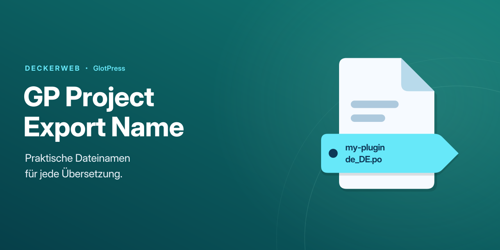
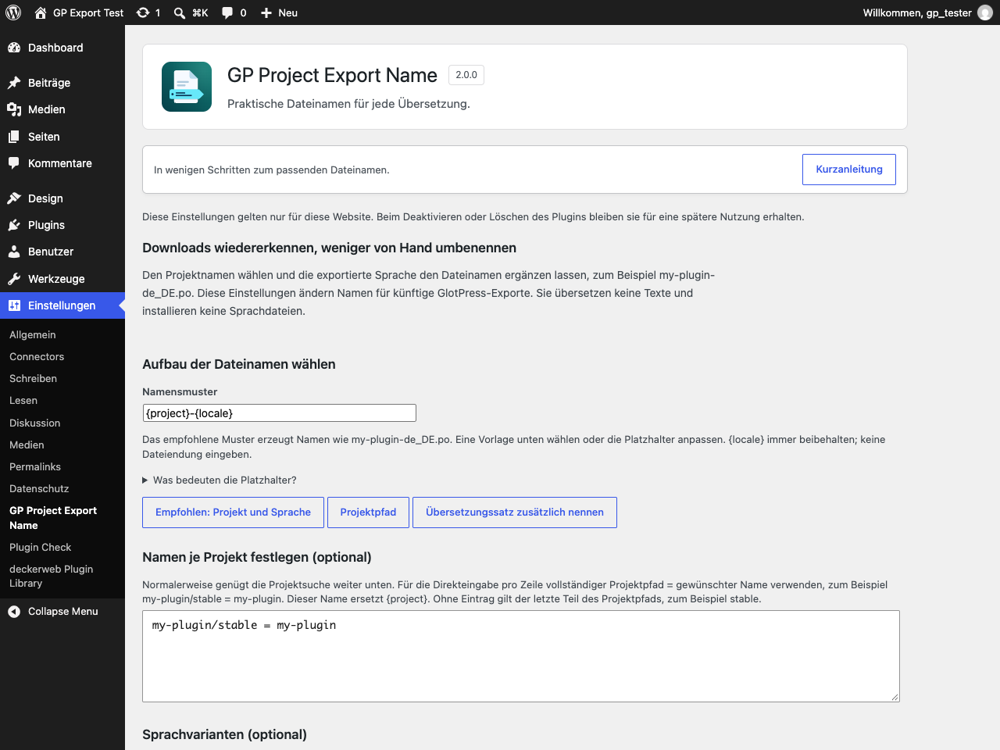
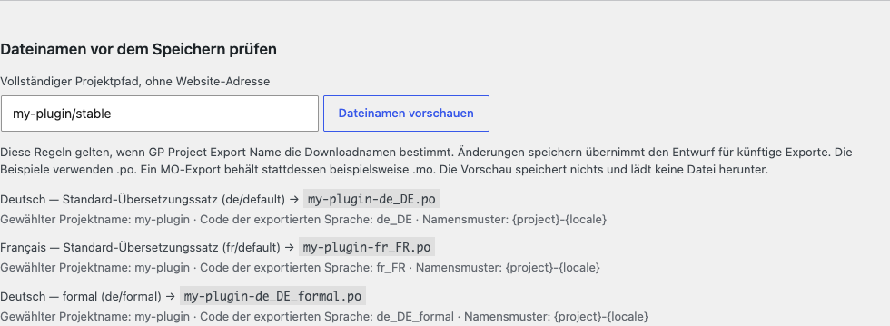

# GP Project Export Name

[English](../README.md)

**2.0.0** · WordPress 6.4+ · PHP 8.1+ · GlotPress 4.0+

[Bebilderte Anleitung](https://github.com/deckerweb/gp-project-export-name/wiki/Anleitung) · [Wiki](https://github.com/deckerweb/gp-project-export-name/wiki)

## Kurzvorstellung

GlotPress-Übersetzungen mit Dateinamen herunterladen, die sich leichter zuordnen und für ihren Einsatz vorbereiten lassen. Einen Projektnamen wählen, die exportierte Sprache beibehalten und Du-, Sie- oder andere Übersetzungssätze unterscheiden. Die Übersetzung selbst bleibt unverändert.

Version 2.0.0 · WordPress ab 6.4 · PHP ab 8.1 · GlotPress ab 4.0 mit einer anderen Permalink-Struktur als Einfach für die Exportfunktionen.

[Kurzanleitung](https://github.com/deckerweb/gp-project-export-name/wiki/Anleitung) · [Vollständige Anleitung und FAQ](https://github.com/deckerweb/gp-project-export-name/wiki/FAQ-Deutsch)

[Auf einen Blick](#auf-einen-blick) · [Erste Schritte](#erste-schritte) · [Kurzanleitung](#kurzanleitung) · [Namensmuster und Platzhalter](#namensmuster-und-platzhalter) · [Dateinamen prüfen](#dateinamen-prüfen) · [Zuständiges Namensplugin](#zuständiges-namensplugin) · [Sammel-Downloads](#sammel-downloads) · [Fester Sprachcode](#fester-sprachcode) · [Updates und Datenschutz](#updates-und-datenschutz) · [Wechsel von der Altversion](#wechsel-von-der-altversion) · [Gespeicherte Daten](#gespeicherte-daten) · [Projekte suchen](#projekte-suchen) · [Einstellungen sichern und importieren](#einstellungen-sichern-und-importieren) · [Einstellungen zurücksetzen](#einstellungen-zurücksetzen) · [Fragen nach Themen](#fragen-nach-themen) · [Änderungsverlauf](#änderungsverlauf)

## Auf einen Blick

- Projektnamen wiedererkennen, statt jede heruntergeladene Datei umzubenennen.
- Die exportierte Sprache einschließlich Sie- und anderer Varianten verwenden.
- Dateinamen aller Übersetzungssätze vor dem Speichern prüfen.
- Projekte suchen, ohne ihren vollständigen Pfad einzutippen.
- Sonst gleiche Namen innerhalb eines Projekts unterscheiden.
- Die Zuständigkeit bei erkannten anderen Namensplugins wählen.
- Dateinamenseinstellungen nach Prüfung sichern, übertragen oder zurücksetzen.
- Die Kurzanleitung mit fünf Schritten direkt auf der Einstellungsseite öffnen.

## Erste Schritte

Das Plugin aktivieren und Einstellungen → GP Project Export Name öffnen. GlotPress muss aktiv sein; unter Einstellungen → Permalinks ist eine andere Struktur als Einfach erforderlich. Die Kurzanleitung auf der Einstellungsseite ist auch erreichbar, bevor GlotPress einsatzbereit ist. Zum Einstieg genügen ihre fünf Schritte; die zusätzlichen Felder können unverändert bleiben.

## Kurzanleitung

GlotPress benennt Downloads nach seiner Projektstruktur. Dieser Name passt nicht immer zur späteren Verwendung der Übersetzung. GP Project Export Name setzt den Downloadnamen aus Projektname, Sprachcode und Sprachvariante zusammen. So entfällt häufig das Umbenennen von Hand.

### Beispiel: eine Plugin-Übersetzung für WordPress

- Typischer GlotPress-Download: `my-plugin-stable-de.po`
- Mit einem hier festgelegten Projektnamen: `my-plugin-de_DE.po`

Beispiel für das Projekt my-plugin/stable mit my-plugin als festgelegtem Namen und dem empfohlenen Namensmuster. Die Sprache stammt aus der exportierten Übersetzung, nicht aus der Sprache des WordPress-Benutzerkontos.

1. **Mit dem empfohlenen Namensmuster starten**

   Bei aktivem GlotPress verwendet das Plugin bereits den letzten Teil des Projektpfads und die exportierte Sprache. Empfohlen: Projekt und Sprache beibehalten, sofern kein anderer Aufbau benötigt wird. Endet ein Projektpfad auf stable, beginnt auch der Dateiname mit stable, bis in Schritt 2 ein anderer Projektname festgelegt wird.

2. **Bei Bedarf den Projektnamen festlegen**

   Unter Projekte suchen und Dateinamen festlegen nach Projektname oder Pfad suchen. In Projektname im Dateinamen den gewünschten Namen ohne Sprachcode und Dateiendung eingeben, zum Beispiel my-plugin. Diesen Namen vormerken wählen. Für ein WordPress-Plugin eignet sich dessen tatsächliche Textdomain: die Kennung, die das Plugin für seine Übersetzungen verwendet. Bei Unklarheit hilft die Dokumentation des jeweiligen Plugins.

3. **Den Dateinamen vor dem Speichern prüfen**

   In der Ergebniszeile des Projekts Vorschau wählen. Angezeigt werden alle zugehörigen Übersetzungssätze, einschließlich Sprachvarianten. Deutsch verwendet normalerweise de_DE; ein deutscher Satz namens formal erhält automatisch de_DE_formal. Die Vorschau erklärt den Aufbau der Namen, speichert aber nichts und lädt keine Datei herunter.

4. **Die gewählten Regeln speichern**

   Änderungen speichern übernimmt den Entwurf für künftige Downloads dieser Website. Die Vorschau allein aktiviert keine Änderungen. Wird ein weiteres Namensplugin erkannt, unter Welches Plugin bestimmt die Dateinamen? bewusst auswählen, welche Regeln gelten sollen.

5. **Wie gewohnt in GlotPress exportieren**

   Den Übersetzungssatz in GlotPress öffnen und den dortigen Export-Link verwenden. Dort auch das benötigte Format wählen. PO dient meist zum Bearbeiten von Übersetzungen; MO ist ein kompiliertes Format, das WordPress verwendet. Das gewählte Format liefert die Endung .po, .mo oder eine andere Endung. Diese Einstellungsseite lädt keine Übersetzungen herunter.

   Ein passender Dateiname installiert oder aktiviert noch keine Übersetzung. Die Zielanwendung benötigt weiterhin das richtige Dateiformat, den passenden Sprachcode und den richtigen Ablageort.

**Nur bei Bedarf:** Eigene Sprachcodes, andere Namensmuster, Sicherungen und Zurücksetzen sind optional. Meist genügen das empfohlene Muster, ein Projektname und eine Vorschau. Erscheint eine Nummer mit --set-, wären sonst zwei Namen innerhalb des Projekts gleich; die Nummer unterscheidet diese Übersetzungssätze.

## Namensmuster und Platzhalter

Das Namensmuster bestimmt die Reihenfolge der Bestandteile. {project} steht für den hier gewählten Projektnamen, sonst für den letzten Teil des GlotPress-Projektpfads. {locale} ist der Code der exportierten Sprache einschließlich ihrer Variante. {path} verwendet den vollständigen Projektpfad mit Bindestrichen statt Schrägstrichen; Namen für {project} werden dabei nicht verwendet. {set} ergänzt den Kurznamen des Übersetzungssatzes. {locale} beibehalten; keine Endung wie .po in das Muster eingeben. Namen erlauben A–Z, a–z, 0–9, Unterstriche und Bindestriche, höchstens 160 Zeichen. Optionale Direkteingaben verwenden vollständiger/Projektpfad = gewünschter-name; einfacher ist die Projektsuche.

## Dateinamen prüfen

In der Ergebniszeile eines Projekts Vorschau wählen oder unter Dateinamen vor dem Speichern prüfen den vollständigen GlotPress-Projektpfad eingeben. Die Website-Adresse gehört nicht dazu. Die Beispiele berücksichtigen ungespeicherte Änderungen, zeigen alle Übersetzungssätze und verwenden .po. Die tatsächliche Endung bestimmt das gewählte Exportformat, auch bei mehrteiligen Endungen wie .l10n.php. Jede Zeile erklärt die tatsächlich verwendeten Bestandteile. Den Status beachten: Ist GlotPress oder ein anderes Namensplugin zuständig, dienen diese Regeln nur als Beispiel. Eine Nummer mit --set- unterscheidet sonst gleiche Namen innerhalb eines Projekts. Kann eine Regel keinen gültigen Namen erzeugen, bleibt der ursprüngliche GlotPress-Name erhalten.

## Zuständiges Namensplugin

Automatisch beibehalten, sofern keine andere Wahl nötig ist. Ohne erkannten Mitbewerber benennt dieses Plugin die Dateien; bei erkanntem GP Download Name oder GP Use Slug for Downloads überlässt es die Benennung dem anderen Plugin. GP Project Export Name verwenden wählt ausdrücklich diese Regeln. GlotPress oder ein anderes Namensplugin verwenden schaltet die eigene Namensänderung aus. Kein Plugin wird deaktiviert. Andere, nicht erkannte Namensplugins können Exporte weiterhin beeinflussen; deren Einstellungen sind gegebenenfalls gesondert zu prüfen.

## Sammel-Downloads

Exporte über GP Bulk Download Translations verwenden diese Namensregeln ebenfalls, wenn dieses Plugin zuständig ist. Das separate Plugin ist optional und übernimmt den eigentlichen Sammel-Download. GP Project Export Name ergänzt keinen eigenen ZIP-Download. Unterschiedliche Dateinamen innerhalb eines Projekts verhindern, dass dort ein Übersetzungssatz einen anderen überschreibt; andere Probleme des externen Plugins werden dadurch nicht behoben.

## Fester Sprachcode

Nur für besondere Konfigurationen: Eine vorhandene Konstante GP_PROJECT_EXPORT_LOCALE kann einen festen Sprachcode vorgeben. Normalerweise ist sie unnötig, weil die exportierte Übersetzung die Sprache liefert. Formelle und eigene Varianten bleiben unterscheidbar. Ein eigener Eintrag Sprache/Übersetzungssatz ersetzt für diesen zusätzlichen Satz den vollständigen Code, auch bei vorhandener Konstante. Doppelte Namen erhalten innerhalb ihres Projekts Nummern mit --set-. Dadurch wird keine Sprache installiert.

## Updates und Datenschutz

Der Updater verbindet sich für öffentliche Release-Metadaten mit api.github.com und für Updatepakete mit GitHub. Dabei werden übliche HTTP-Daten wie die Server-IP übertragen. Keine Telemetrie und keine Zugangsdaten erforderlich. Metadaten werden zwischengespeichert. Der optionale Library-Onlinekatalog ist anfangs aus; seine Oberfläche erläutert Aktivierung und Installation. Updatepakete werden auf Identität, angebotene Version und kompatible Anforderungen geprüft. Vorabversionen werden nicht als stabile Updates angeboten.

## Wechsel von der Altversion

WordPress stuft 2018.09.15 als neuer als 2.0.0 ein. Das Installations-ZIP unter Plugins → Plugin hinzufügen → Plugin hochladen auswählen und das Ersetzen des vorhandenen Plugins bestätigen. Vorher die Website sichern. Der neue Updater kann nicht nachträglich in der unveränderten Altversion laufen. Nach diesem einmaligen manuellen Wechsel übernimmt der enthaltene Updater veröffentlichte stabile 2.x-Updates.

## Gespeicherte Daten

Beim Deaktivieren oder Löschen des Plugins bleiben die Dateinamenseinstellungen erhalten. Sie gelten für die jeweilige Website, auch bei Netzwerkaktivierung. Dieses Plugin kopiert oder speichert keine Übersetzungstexte. Dateinamenseinstellungen zurücksetzen erlaubt das bewusste Entfernen ausgewählter Regeln nach vorheriger Prüfung. Library-Einstellungen bleiben davon getrennt und werden standardmäßig erhalten; temporäre Library-Daten werden erst bereinigt, wenn kein installiertes deckerweb-Hostplugin sie mehr benötigt. Temporäre Update-Metadaten dieses Repositorys werden bei Deinstallation entfernt.

## Projekte suchen

Unter Projekte suchen und Dateinamen festlegen nach Projektname oder Pfad suchen. Je Seite erscheinen bis zu 20 Projekte. Projektname im Dateinamen bearbeiten und Diesen Namen vormerken wählen; anschließend Änderungen speichern. Das Feld liefert {project}; ein Muster nur mit {path} behält stattdessen den vollständigen Pfad. Vorschau öffnet die Übersetzungssätze des gewählten Projekts. Die optionale Direkteingabe oben erlaubt mehrere Zeilen. Hinweise zeigen fehlende gespeicherte Projektpfade, ungültige Namen und doppelte Namen innerhalb eines Projekts. Verschiedene Projekte dürfen bewusst gleichnamige Dateien erzeugen; diese werden nicht global umbenannt.

## Einstellungen sichern und importieren

Unter Einstellungen sichern oder wiederherstellen die Einstellungssicherung herunterladen (.json). Die Datei enthält die gespeicherten Dateinamenseinstellungen dieser Website, keine Übersetzungen, Benutzerkonten oder ungespeicherten Änderungen. Vor größeren Änderungen ist diese Sicherung hilfreich.

Zum Wiederherstellen oder Übertragen Einstellungen importieren öffnen und die Datei auswählen (höchstens 64 KB). Alternativ ihren JSON-Text einfügen. Import prüfen zeigt alle Ergänzungen, Ersetzungen und Entfernungen. Diese Änderungen bestätigen ersetzt die gespeicherten Dateinamenseinstellungen der Website; sie werden nicht zusammengeführt. Ein Strich bedeutet, dass ein Eintrag entfernt wird.

Projektpfade und Angaben Sprache/Übersetzungssatz müssen zur Zielwebsite passen. Fehlende Projekte werden gemeldet; ihre Einträge bleiben erhalten. Die erste Regelprüfung umfasst die ersten 20 Projekte; weitere Seiten lassen sich in der Projektsuche prüfen. Werden währenddessen andere Einstellungen gespeichert, wird die alte Bestätigung abgelehnt, damit diese Änderungen nicht überschrieben werden. Import benötigt GlotPress und Administratorrechte. Mit eingefügtem JSON funktioniert er auch ohne JavaScript.

## Einstellungen zurücksetzen

Dateinamenseinstellungen zurücksetzen öffnen und den gewünschten Bereich wählen: Namensmuster, Projektnamen, Sprachcodes, das zuständige Namensplugin oder alle Dateinamenseinstellungen. Auch ein einzelner Projektname oder eigener Sprachcode lässt sich entfernen. In diesem Fall den exakt gespeicherten Projektpfad oder die Angabe Sprache/Übersetzungssatz eintragen.

Zurücksetzen prüfen wählen, alte und neue Werte vergleichen und anschließend Diese Änderungen bestätigen. Abbrechen kehrt ohne Übernahme zurück. Übersetzungsinhalte und Library-Einstellungen bleiben unberührt.

## Screenshots

## Fragen nach Themen

### Muss jedes Feld ausgefüllt werden?

Nein. Das empfohlene Namensmuster beibehalten. Nur wenn der letzte Teil des GlotPress-Projektpfads nicht passt, einen Projektnamen festlegen; anschließend Vorschau und Speichern verwenden. Eigene Sprachcodes sowie Sicherung und Zurücksetzen sind optional.

### Welcher Name passt für ein WordPress-Plugin?

Die tatsächliche Textdomain des Plugins verwenden: seine Kennung für Übersetzungen, zum Beispiel my-plugin. Der sichtbare Projekttitel ist nicht automatisch die Textdomain. Zusätzlich zum Dateinamen müssen weiterhin Format, Sprachcode und Ablageort in WordPress stimmen.

### Wo wird die Übersetzung heruntergeladen?

Über den normalen Export-Link im Übersetzungssatz in GlotPress. Diese Einstellungsseite legt nur Dateinamen fest und zeigt Beispiele; sie lädt keine Übersetzungen herunter und installiert sie nicht.

### Ändert das Plugin Übersetzungsinhalte?

Nein. Nur die Downloadnamen ändern sich. GlotPress regelt weiterhin Zugriff und Exportinhalte.

### Was ist ein Übersetzungssatz oder eine Sprachvariante?

Ein Übersetzungssatz bündelt Übersetzungen in GlotPress. Für eine Sprache können mehrere existieren, etwa Deutsch mit Du- und Sie-Anrede. Ein Satz namens formal erhält automatisch _formal; andere zusätzliche Sätze erhalten -x- und ihren Kurznamen. Die Zusätze unterscheiden Dateien, installieren aber keine WordPress-Sprachen.

### Speichert die Vorschau Einstellungen?

Nein. Änderungen speichern übernimmt die Regeln getrennt. Projektsuche, Dateiauswahl und Dateinamenvorschau benötigen JavaScript; Speichern und Import mit eingefügtem JSON sowie Zurücksetzen funktionieren ohne JavaScript.

### Warum lassen sich die Dateinamenseinstellungen nicht ändern?

GlotPress ab Version 4.0 muss mit einer anderen Permalink-Struktur als Einfach aktiv sein. Zum Speichern sind Administratorrechte erforderlich. Vorhandene Einstellungen und die Kurzanleitung bleiben erreichbar, während die Exportfunktionen pausieren.

[Alle Fragen nach Themen](https://github.com/deckerweb/gp-project-export-name/wiki/FAQ-Deutsch)

## Änderungsverlauf

### 2.0.0 · 2026-10-27

- **Neu:** Projektnamen, Namensmuster und Sprachvarianten auf einer eigenen Einstellungsseite festlegen – mit Projektsuche und Vorschau.
- **Neu:** Einstellungen sichern, nach Prüfung importieren oder gezielt zurücksetzen; die Kurzanleitung mit fünf Schritten jederzeit öffnen.
- **Neu:** Mit deckerweb Library und geprüften GitHub-Updates.

- **Verbessert:** Die Sprache der exportierten Übersetzung verwenden, formelle und eigene Varianten unterscheiden sowie doppelte Dateinamen innerhalb eines Projekts verhindern.
- **Verbessert:** Bei erkannten anderen Namensplugins festlegen, wessen Regeln gelten.
- **Verbessert:** Barrierearm bedienbare zweisprachige Dokumentation, bebilderte Anleitung und Plugin-Icon ergänzt.

- **Behoben:** Bei ungültigen erzeugten Namen den ursprünglichen GlotPress-Dateinamen erhalten; Exportinhalt und mehrteilige Dateiendungen beibehalten.

- **Sonstiges:** Benötigt WordPress 6.4, PHP 8.1 und GlotPress 4.0 oder neuer. Einstellungen gelten je Website und bleiben nach dem Löschen erhalten.
- **Sonstiges:** Von Version 2018.09.15 per ZIP-Upload mit bestätigtem Ersetzen wechseln: WordPress stuft die alte datumsbasierte Version als neuer ein.

### 2018.09.15 · 2018-09-15

- **Verbessert:** Verarbeitung der Dateinamen vereinfacht.

- **Behoben:** Exportdateinamen wiederhergestellt.

### 2016.09.02 · 2016-09-02

- **Neu:** Erste Veröffentlichung.

## Projekt und Hilfe

2016 von David Decker – DECKERWEB für einen eigenen GlotPress-Ablauf entwickelt.

[GitHub](https://github.com/deckerweb/gp-project-export-name) · [Issues](https://github.com/deckerweb/gp-project-export-name/issues) · [Sicherheitsrichtlinie](../SECURITY-de.md)

Copyright © 2016–2026 David Decker – DECKERWEB. Plugin-Lizenz: GPL v2 oder höher.

Library 1.1.0 / Updater 2.2.1: David Decker – DECKERWEB, GPL-2.0-or-later.

[Ko-fi](https://ko-fi.com/deckerweb) · [Buy Me a Coffee](https://buymeacoffee.com/daveshine) · [PayPal](https://paypal.me/deckerweb)
